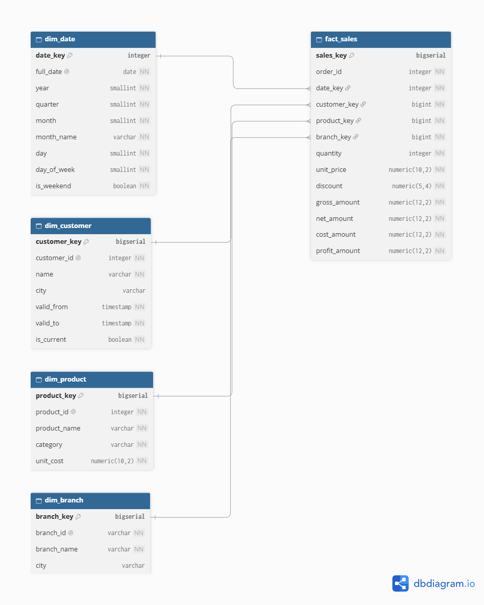
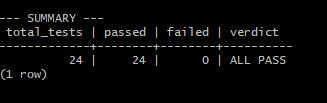

# PostgreSQL Sales Data Warehouse

[](https://github.com/AhmadQD/sales-data-warehouse/actions/workflows/test.yml)

A portfolio project demonstrating a PostgreSQL data warehouse, a layered ETL pipeline, data quality validation, dimensional modeling, SQL testing, and backup and recovery practices.

> **Dataset:** All source data is synthetic and generated with a fixed random seed (`SEED=42`). No real customer or sales data is used.

## Project Highlights

- **Data warehousing:** Star schema with one fact table and four dimensions.
- **Layered ETL:** `raw` → `staging` → `warehouse`.
- **Data quality:** Validation against expected anomaly counts in a synthetic ground-truth catalog.
- **SQL testing:** 18 acceptance tests covering data integrity and business rules.
- **Incremental loading:** Watermark-based processing with documented limitations.
- **Data lineage and auditing:** Raw source preservation, rejected-row tracking, and ETL run history.
- **Database security:** Role-based access and separation of analytical access from raw and staging data.
- **Backup and recovery:** Custom-format PostgreSQL backups, retention, and a documented restore test.
- **Analytics:** SQL views answering eight analytical questions, with a Power BI report included.

## Architecture

The pipeline separates source ingestion, data cleaning, and analytical storage.

```text
Synthetic Source Files
        |
        v
   RAW SCHEMA
  Source snapshots
        |
        v
  STAGING SCHEMA
 Cleaning, validation,
 deduplication, ETL logs
        |
        v
 WAREHOUSE SCHEMA
 Fact and dimension tables
        |
        v
 Analytical Views
        |
        v
  Reporting / Analysis
```

### Star Schema



The warehouse contains:

- **Fact table:** `warehouse.fact_sales`
- **Dimensions:** `dim_date`, `dim_customer`, `dim_product`, and `dim_branch`
- **Measures:** Gross amount, net amount, cost amount, and profit amount
- **Unknown members:** Used to preserve fact records with missing dimension identifiers.

The current synthetic dataset contains one product per order, so the fact table uses one row per `order_id`. A real retail system with multiple line items per order would require a different fact grain.

See [Star Schema Documentation](docs/star_schema.md).

## Data Quality and ETL Decisions

The pipeline handles several intentionally injected data issues:

| Issue | Expected count | Handling |
|---|---:|---|
| Mixed date formats | 3,000 | Normalize dates |
| Missing customer IDs | 1,000 | Preserve sales using the Unknown customer member |
| Dirty branch IDs | 2,000 | Trim and normalize values |
| Negative quantities | 500 | Reject and record the reason |
| Missing discounts | 2,000 | Apply the documented default |
| Exact duplicate rows | 1,000 | Remove duplicates |

The expected counts total **9,500 injected anomalies or duplicate instances** across the defined categories.

### Validation Method and Limitations

The ETL quality report compares observed anomaly counts with expected counts in the synthetic error catalog. The report exits with a non-zero status when a count does not match, allowing the CI workflow to detect regressions.

**Important limitation:** This is count-based validation, not record-level accuracy measurement. The catalog stores aggregate counts rather than record-level anomaly labels. Therefore, the current validation cannot reliably establish record-level precision, recall, false positives, or false negatives.

A reported match of 9,500 expected instances does **not** prove that every individual anomaly was detected correctly. Record-level ground-truth labels would be required to measure those metrics.

Results on synthetic data should not be interpreted as a guarantee of equivalent performance on real-world data.

See [ETL Decisions](docs/etl_decisions.md) and [`quality_report.py`](scripts/etl/quality_report.py).

## Test Results

The project includes an SQL acceptance test runner:

[`scripts/db/12_master_test_runner.sql`](scripts/db/12_master_test_runner.sql)

The tests cover areas such as:

- Expected row counts and duplicate prevention
- Valid quantities, prices, and discount ranges
- Referential integrity between facts and dimensions
- Orphan-record checks
- Financial calculation consistency
- Data quality and warehouse integrity rules

The repository documents a successful **18/18 acceptance-test run**. See the [GitHub Actions workflow](https://github.com/AhmadQD/sales-data-warehouse/actions/workflows/test.yml) for CI status.



## Dataset and Results

The repository documents the following results:

| Metric | Reported value |
|---|---:|
| Raw sales records | 101,000, including injected duplicates |
| Rejected negative-quantity records | 500 |
| Duplicate records removed | 1,000 |
| Clean CI fact rows | 99,500 |
| Local development fact rows | 99,570 |
| Gross sales, local snapshot | $30.8M |
| Profit, local snapshot | $7.6M |
| Analytical SQL views | 11 |
| Analytical questions | 8 |
| Acceptance tests | 18 |

**Interpreting row counts:** The clean CI dataset produces 99,500 fact rows. The local development database may contain up to 70 additional test rows from incremental-loading experiments, resulting in 99,570 rows.

The financial totals above are reported for the local development snapshot; they should not be assumed to match the clean CI dataset without recalculation.

## Incremental Loading: Design and Limitations

The sales staging loader uses a watermark stored in `warehouse.etl_watermark`. It processes rows whose `order_id` is greater than the last loaded key and updates the watermark within the transaction.

This approach is suitable for the project's controlled, synthetic source, where order identifiers are generated monotonically.

**Known limitations:**

- Late-arriving records with an older `order_id` may be skipped.
- Changes to existing orders are not applied when conflicts use `ON CONFLICT DO NOTHING`.

These limitations are documented design trade-offs, not guarantees of production-grade change capture.

Potential improvements for a real source include a composite watermark based on update timestamp and identifier, appropriate `UPSERT` logic, or Change Data Capture (CDC).

See [`load_staging_sales.py`](scripts/etl/load_staging_sales.py) and [ETL Decisions](docs/etl_decisions.md).

## Backup and Recovery

The project documents a backup process using:

- `pg_dump -Fc` for custom-format database backups
- `pg_dumpall --roles-only` for role definitions
- Retention of the seven most recent backups
- `pg_restore --list` to inspect backup archives

A restore test documented on October 23, 2026, restored a backup to a separate database and passed the 18 acceptance tests.

**Scope limitation:** The backup process is currently manual and local. Automated scheduling, off-site storage, encryption, and recovery on a separate PostgreSQL cluster are not implemented as part of the current project.

See [Backup Strategy](docs/backup_strategy.md).

## Documentation

| Document | Description |
|---|---|
| [`docs/star_schema.md`](docs/star_schema.md) | Fact grain, dimensions, keys, and measures |
| [`docs/etl_decisions.md`](docs/etl_decisions.md) | Design decisions, alternatives, and limitations |
| [`docs/data_dictionary.md`](docs/data_dictionary.md) | Tables and column definitions |
| [`docs/backup_strategy.md`](docs/backup_strategy.md) | Backup and recovery procedure |
| [`docs/analytical_questions.md`](docs/analytical_questions.md) | Eight analytical questions |

## Power BI Report

The repository includes a four-page Power BI report, along with a PDF and screenshots.

| Page | Preview |
|---|---|
| Sales Overview |  |
| Branches |  |
| Customers |  |
| ETL Quality |  |

To interact with the report, open `dashboards/sales_dashboard.pbix` in Power BI Desktop.

## Quick Start

### Prerequisites

- PostgreSQL 14 or later
- Python 3.10 or later
- Git
- Bash or Git Bash on Windows

The commands below follow the database initialization and ETL sequence used by the repository's CI workflow. They assume PostgreSQL is running and that your local PostgreSQL credentials and permissions are configured appropriately.

### 1. Clone the Repository

```bash
git clone https://github.com/AhmadQD/sales-data-warehouse.git
cd sales-data-warehouse
```

### 2. Create a Python Environment

```bash
python -m venv .venv
source .venv/bin/activate
python -m pip install --upgrade pip
pip install psycopg2-binary pandas openpyxl python-dotenv
```

On Windows Command Prompt, activate the environment with:

```bat
.venv\Scripts\activate
```

### 3. Configure Database Connection

Create a local `.env` file in the repository root. Use the connection settings for your own PostgreSQL installation:

```dotenv
DB_HOST=localhost
DB_PORT=5432
DB_NAME=sales_dw
DB_USER=postgres
DB_PASSWORD=your_local_password
```

Replace the example password and other settings as needed. Do not commit `.env` or real credentials to Git.

### 4. Initialize the Database

Run the SQL scripts from the repository root, in this order:

```bash
psql -U postgres -v ON_ERROR_STOP=1 -f scripts/db/01_create_database.sql
psql -U postgres -d sales_dw -v ON_ERROR_STOP=1 -f scripts/db/02_roles_and_grants.sql
psql -U postgres -d sales_dw -v ON_ERROR_STOP=1 -f scripts/db/04_create_raw_tables.sql
psql -U postgres -d sales_dw -v ON_ERROR_STOP=1 -f scripts/db/05_create_staging_tables.sql
psql -U postgres -d sales_dw -v ON_ERROR_STOP=1 -f scripts/db/07_create_dim_date.sql
psql -U postgres -d sales_dw -v ON_ERROR_STOP=1 -f scripts/db/08_create_warehouse_dims.sql
psql -U postgres -d sales_dw -v ON_ERROR_STOP=1 -f scripts/db/09_create_fact_sales.sql
psql -U postgres -d sales_dw -v ON_ERROR_STOP=1 -f scripts/db/11_create_watermark.sql
psql -U postgres -d sales_dw -v ON_ERROR_STOP=1 -f scripts/db/13_create_views.sql
psql -U postgres -d sales_dw -v ON_ERROR_STOP=1 -f scripts/db/14_create_views.sql
psql -U postgres -d sales_dw -v ON_ERROR_STOP=1 -f scripts/db/15_fix_etl_quality_view.sql
```

The role and database setup scripts may require administrative privileges. Ensure their local configuration is appropriate before running them.

### 5. Generate Data and Run the ETL Pipeline

Run these commands from the repository root, in order:

```bash
python scripts/generate_data.py
python scripts/etl/load_raw.py
python scripts/etl/load_staging_dims.py
python scripts/etl/load_staging_sales.py
python scripts/etl/load_staging_returns.py
python scripts/etl/load_warehouse_dims.py
python scripts/etl/load_fact_sales.py
```

The generator creates synthetic source files in `data/raw/`.

### 6. Run the Acceptance Tests and Quality Report

```bash
psql -U postgres -d sales_dw -v ON_ERROR_STOP=1 -f scripts/db/12_master_test_runner.sql
python scripts/etl/quality_report.py
```

A successful acceptance-test run should report 18 passing tests. The quality report checks observed counts against the synthetic anomaly catalog.

**Note:** These steps follow the CI workflow but have not been verified here as a fresh installation on every operating system. Local role permissions, PostgreSQL credentials, and existing database state may require adjustments.

## Project Scope

This is a learning and portfolio project designed to demonstrate database development, ETL design, data validation, SQL testing, and recovery practices.

It is **not presented as a production-ready warehouse**. Before production use, the incremental-loading strategy, operational monitoring, credential management, automated backups, off-site disaster recovery, and record-level data quality metrics would need further development and testing.

## License

See the repository's license file, if provided.